# Real-Time Vision Pipeline

A small C++17 application using OpenCV and ONNX Runtime. It reads frames from the default camera, runs YOLO inference, draws detections, and reports timing and frame-rate measurements. Earlier grayscale, Canny, CLAHE, color-space, histogram, and profiling examples remain in the source and assets, but their per-frame processing path is currently commented out.

## Pipeline

The application is implemented in [`src/main.cpp`](src/main.cpp) and runs these active stages for each camera frame:

1. **Camera capture thread**: opens camera device 0, requests 640×480 using `CAP_PROP_FRAME_WIDTH` and `CAP_PROP_FRAME_HEIGHT`, and prints the camera-reported resolution and FPS. A dedicated thread continuously reads frames and publishes the latest one; the requested mode may not be supported, so the reported properties come from the capture backend.
2. **Frame handoff**: a mutex protects the shared latest-frame `cv::Mat` while the capture thread publishes a new frame and the processing thread copies a snapshot. The processing loop does not wait for one camera read per inference iteration; it works on the most recently available frame, and intermediate camera frames can be skipped rather than queued.
3. **YOLO input preparation**: preserves the captured frame's aspect ratio while resizing it to fit 640×640, centers it on a value-114 letterbox, reverses BGR-to-RGB channel ordering during HWC-to-CHW packing, scales pixels to float `[0,1]`, and stores the image in CHW format without a separate `cv::cvtColor()` pass.
4. **Inference and detections**: ONNX Runtime evaluates the `[1, 3, 640, 640]` input. Candidate detections are confidence-filtered and passed through NMS; remaining boxes are mapped back to the captured-frame coordinates and drawn on the live image.
5. **Display and keyboard input**: displays the annotated frame in the `YOLO Detection` window. Press `q` to exit.

An atomic `cameraRunning` flag coordinates shutdown: the main thread clears it when processing exits, then joins the capture thread before releasing the camera.

The former grayscale, Canny, CLAHE, HSV/Lab conversion, histogram, and diagnostic-printing pipeline is retained in the source but commented out in the active loop. The historical images and descriptions below document those earlier experiments.

## YOLO and ONNX Inference

The application creates an ONNX Runtime session from `../yolo26n.onnx` relative to the process's working directory. The model file must be present at that path. The session's first input and output names are queried from the model rather than hard-coded.

For every captured frame, the YOLO input is prepared as follows:

1. Resize the original OpenCV BGR camera frame to fit within 640×640 while preserving its aspect ratio.
2. Place it in the center of a 640×640 canvas filled with pixel value 114, recording the scale and padding offsets for later box-coordinate mapping.
3. Copy the letterboxed frame into channel planes while reversing the OpenCV BGR channel order to RGB as part of the HWC-to-CHW layout conversion. This avoids a separate `cv::cvtColor()` pass and still produces the expected RGB tensor input.
4. Convert the 8-bit channel values to 32-bit floating point and divide by 255, giving values in `[0,1]`.
5. Reorder the pixels from interleaved HWC layout (height, width, channels) to planar CHW layout (channels, height, width).
6. Wrap those values in a float tensor with shape **`[1, 3, 640, 640]`** (batch, channels, height, width) and run the ONNX session.

The code assumes the model's output is a float tensor shaped **`[1, 84, 8400]`**: 84 channels for each of 8,400 candidate predictions. It treats channels 0–3 as box center `x`, center `y`, width, and height, and channels 4–83 as 80 class scores. For each captured frame, it selects each candidate's highest class score, filters candidates below a confidence threshold of `0.50`, applies NMS with an IoU threshold of `0.45`, and draws the remaining detections.

The code removes letterbox padding, maps and clips box coordinates to the captured frame, applies NMS, and draws labeled boxes in the live `YOLO Detection` window. The model output dimensions, channel layout, class count, and tensor type are model-specific assumptions and must match the ONNX file being used.

## YOLO Detection Results

The following screenshots are saved results from the detection visualization. They show a green bounding box around a detected subject; the close-up includes the displayed class index `0` and confidence `0.895924`.

| Detection visualization | Full-window capture |
| --- | --- |
| 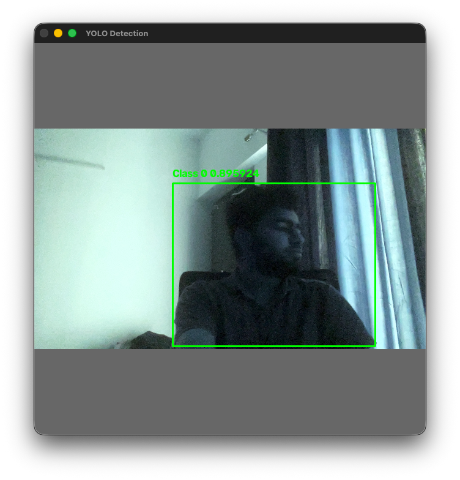 | 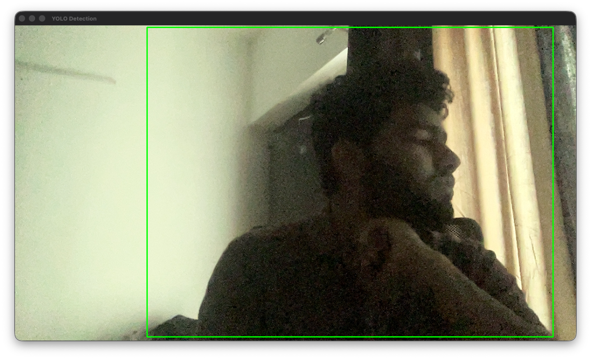 |

These screenshots are recorded examples of the annotated detection view.

## Earlier Pipeline: Function Composition

The earlier image-processing pipeline kept small, focused functions outside `main()` and composed them into a higher-level operation:

```text
preprocessFrame(frame)
  ├── resizeFrame(frame, 640, 360)
  └── enhanceWithCLAHE(resizedFrame)
```

This kept each image-processing step understandable while giving `main()` a clear description of the per-frame workflow. Reusing a resized frame avoids duplicate image work. These helper functions remain in the source, but this preprocessing composition is not part of the active YOLO loop.

## OpenCV API Used

- `cv::VideoCapture` opens a camera; `isOpened()` tests whether the device was opened; the stream extraction operator reads a frame; `release()` closes the capture device.
- `cv::Mat` stores the original, resized, and grayscale images.
- `cv::resize` resamples an image to a specified size. The active camera request is 640×480; YOLO preprocessing then scales and letterboxes the captured image to 640×640.
- `cv::Size` represents the target width and height passed to `cv::resize`.
- `cv::cvtColor` applies a color-space conversion. The active YOLO preprocessing uses `cv::COLOR_BGR2RGB`; the earlier image-processing experiment also used `cv::COLOR_BGR2GRAY`.
- `cv::Mat::convertTo` converts image depth and optionally scales pixel values; YOLO preprocessing selects 32-bit float and scales image values by `1.0 / 255.0`.
- `cv::GaussianBlur` reduces high-frequency noise before edge detection in the earlier pipeline; `cv::Size(5, 5)` sets the kernel dimensions and `sigmaX=0` asks OpenCV to derive the Gaussian sigma.
- `cv::Canny` detects edges using gradient magnitude, non-maximum suppression, and two-threshold hysteresis. The earlier pipeline used thresholds `50` and `150`; this stage is not active in the current YOLO loop.
- `cv::createCLAHE` creates a CLAHE processor. The retained earlier image-processing experiment uses clip limit `2.0` and an `8×8` tile grid; that pipeline is currently commented out of the live loop.
- `cv::COLOR_BGR2HSV`, `cv::COLOR_BGR2Lab`, and `cv::COLOR_Lab2BGR` convert between BGR, HSV, and Lab color spaces. Lab separates lightness (L) from chromatic a/b components, allowing contrast enhancement on L while preserving the original color channels.
- `cv::split` separates a multi-channel matrix into individual channel matrices. The active YOLO input conversion uses it to create RGB channel planes before copying them into contiguous CHW tensor storage; `cv::merge` combines channel matrices back into an image in the earlier color-processing pipeline.
- `cv::calcHist` computes a histogram. The earlier image-processing experiment used it for one 8-bit L channel, 256 bins, and a value range `[0, 256)`.
- `cv::meanStdDev` calculates per-channel mean and standard deviation. The earlier experiment used it to compare original and CLAHE-enhanced L-channel distributions; a larger standard deviation generally indicates a wider spread of lightness values, not necessarily better image quality.
- `cv::Mat::rows`, `cols`, `channels()`, `total()`, and `type()` expose frame metadata; `at<cv::Vec3b>` accesses a BGR pixel and `at<unsigned char>` accesses one grayscale pixel.
- `cv::imshow` displays a frame, `cv::waitKey` handles GUI events and keyboard input, and `cv::destroyAllWindows` closes OpenCV windows.
- `cv::imwrite` encodes and saves the selected frame as an image file.
- `CV_VERSION` reports the OpenCV version used at compile time.

## Profiling and Bottleneck Notes

The active YOLO loop uses `std::chrono` timers in `main()` to inspect time spent at each major stage. It prints per-frame measurements and reports processing FPS over approximately 0.5-second windows. The counter and window start time are reset after each report, so this is a short-window rate rather than a cumulative rate since application startup.

| Measurement printed by the application | Work included |
| --- | --- |
| `Capture Time` | The processing thread's mutex-protected copy of the latest published frame. Camera reading itself happens concurrently in the capture thread and is not included in this timer. |
| `Letterbox` | Aspect-ratio-preserving resize and placement on the 640×640 padded canvas. |
| `Float conversion` | Conversion to `CV_32FC3` and normalization by `1/255`. |
| `HWC -> CHW` | `cv::split` of RGB channels and `memcpy` into the planar model-input tensor. |
| `YOLO Preprocess Time` | Letterbox, float conversion, and HWC→CHW together. |
| `Current Inference` / `Inference Time` | The ONNX Runtime `session.Run()` call. |
| `Decode Time` | Candidate class-score scan and confidence-threshold filtering. |
| `NMS` | Non-maximum suppression over the filtered detections. |
| `Drawing` | Mapping boxes to the camera-frame coordinates and drawing labels/rectangles. |
| `Display` | `imshow` and one `waitKey(1)` call. |
| `imshow` / `waitKey` | The current code reports `imshow` and `waitKey(1)` separately. |
| `Processing FPS` | Frames completed by the processing loop divided by elapsed time in the current approximately 0.5-second reporting window. It excludes camera frames that were captured but superseded before processing. |
| `Total Frame Time` | A separate timer around one processing-loop iteration; its print condition uses the older `frameCount1` counter and may not align with every processing-FPS report. |

### Optimizations tried and observed impact

- **Profile before optimizing:** separate timers were added around camera capture, letterboxing, float conversion, tensor layout conversion, inference, decoding, NMS, drawing, display, and the full frame. This makes it possible to compare stages instead of inferring bottlenecks from FPS alone. The instrumentation currently prints several timing lines every frame; console I/O is part of total frame time and can itself reduce throughput.
- **HWC-to-CHW conversion:** the earlier per-pixel conversion was replaced with OpenCV `cv::split()` followed by `std::memcpy()` of each contiguous channel plane. In the local comparison this reduced the HWC→CHW conversion time by about **50%**. That is a stage-level observation, not a 50% increase in whole-pipeline FPS; inference and other stages are unchanged.
- **ONNX Runtime graph optimization:** the session sets `GraphOptimizationLevel::ORT_ENABLE_ALL` before model creation. This enables ONNX Runtime's available graph optimizations, but the FPS impact depends on the model, execution provider, and machine.
- **Camera capture mode:** the application requests 640×480 and prints the capture backend's reported resolution and FPS. Compared with the earlier 1280×720 mode, 640×480 contains one third as many camera pixels, reducing camera-frame transfer and work performed before model input preparation. A camera backend may ignore the requested size, so check the reported resolution.
- **Letterboxing and model input size:** the captured image is still letterboxed to a fixed 640×640 tensor. For a 640×480 source, the resized image occupies 640×480 with padding above and below. Thus reducing the camera capture resolution does **not** reduce the ONNX model's 640×640 input shape or its per-inference tensor dimensions.

- **Decoupled capture and processing:** a dedicated `std::thread` reads camera frames while the main thread performs preprocessing, inference, post-processing, and display. The producer replaces a shared latest-frame image; the consumer copies it while holding the same `std::mutex`. This avoids serializing camera reads with inference and prevents a backlog of stale frames. If processing is slower than capture, some captured frames are intentionally skipped, favoring low latency over processing every frame.
- **Thread coordination:** `std::atomic<bool> cameraRunning` signals the capture worker to stop. On exit, the main thread clears the flag and joins the worker before releasing `VideoCapture`, avoiding access to the camera after release.
- **Observed FPS change:** after separating capture and processing and reducing avoidable waiting/work in the processing path, the reported processing FPS increased from approximately **13–14 FPS to 39–40 FPS** in the observed run (roughly 2.9× throughput). This is the application's processing-loop FPS, not a claim that the camera itself captures at 39–40 FPS. Treat it as a run-specific observation; the result depends on camera/backend, machine, ONNX Runtime execution provider, and workload.
- **Remaining measurement caveat:** timing and per-frame console output add work and can affect measured throughput. Compare runs under the same conditions and distinguish the processing loop's rate from camera-reported FPS and camera capture rate. Camera-reported FPS is backend metadata and may be unavailable or zero.

The older grayscale/Canny/CLAHE FPS samples below belong to the earlier image-processing pipeline and are not measurements of the current YOLO loop.

## Historical Histogram Analysis

The earlier image-processing pipeline analyzed the lightness channel of the Lab frame before and after CLAHE. `cv::calcHist` created a 256-bin frequency histogram across the 8-bit L values from 0 through 255. The program then grouped adjacent bins into five bands (0–49, 50–99, 100–149, 150–199, and 200–255) and summed the pixel counts in each band for both images. These totals show how lightness values are distributed across dark to bright ranges; they are counts, not percentages, because the histogram is not normalized.

`cv::meanStdDev` provided complementary summary statistics. The mean reports average L-channel intensity, while standard deviation describes the spread around that mean. CLAHE is local and contrast-limited, so a histogram may redistribute counts and increase local detail without necessarily changing the global mean dramatically. Histogram counts and standard deviation help quantify the transformation, but should be interpreted alongside the image because they do not measure perceptual quality by themselves.

## Color-Space Captures

| Resized BGR input | CLAHE-enhanced BGR | HSV channel data | Lab channel data |
| --- | --- | --- | --- |
| 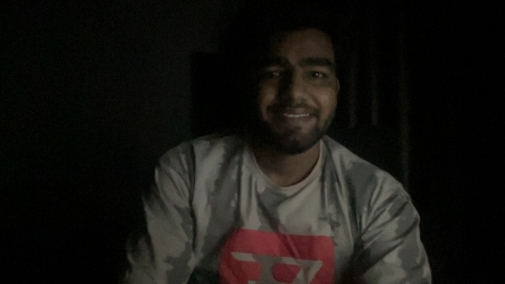 | 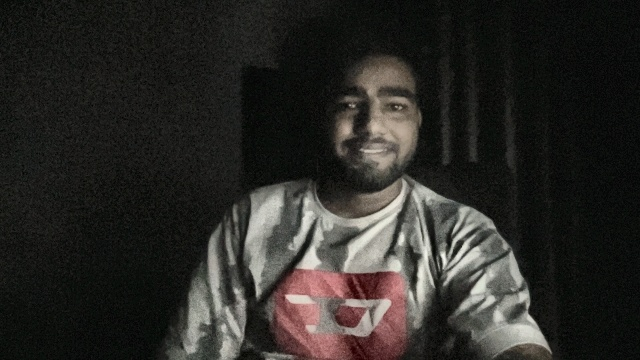 | 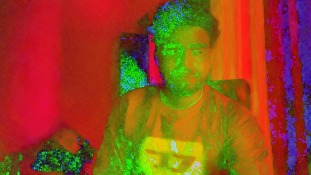 | 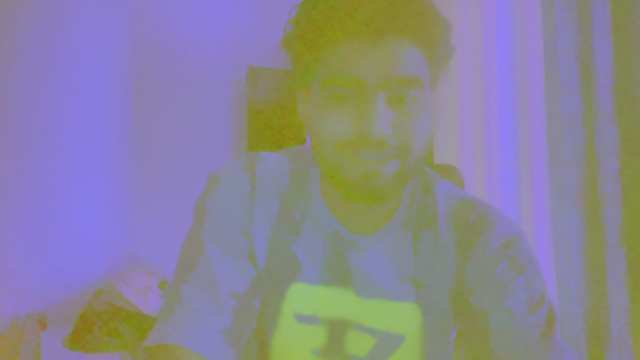 |
| The resized camera frame before the Lab lightness enhancement. | A brighter, higher-local-contrast result reconstructed using enhanced L and original a/b channels. | HSV stores hue, saturation, and value. Displaying those raw channels as BGR produces false colors; this is a data visualization, not a natural-color HSV conversion. | Lab stores lightness and two chromatic channels. Displaying raw Lab channel values as BGR also produces false colors; the image is included to show the encoded channel data. |

## Historical Image-Processing Captures

### Original camera frame


This archived camera frame is 1280×720 and has three BGR channels. It is from the earlier image-processing experiment, not a guarantee of the current requested 640×480 camera mode.

### Resized color frame


This archived image was reduced from 1280×720 to 640×360 while retaining three BGR channels. Its pixel dimensions, and therefore pixel count, are one quarter of the original. The smaller frame was the input to the grayscale conversion.

### Grayscale frame


The frame remains 640×360, but BGR color has been converted to one grayscale channel using `cv::cvtColor` and `cv::COLOR_BGR2GRAY`. It was used for Gaussian blur, Canny, and the grayscale CLAHE profiling pass in the earlier pipeline.

## CLAHE

Contrast Limited Adaptive Histogram Equalization (CLAHE) improves local contrast rather than applying one global histogram adjustment to the whole image. It divides the image into tiles, equalizes each tile's histogram, limits histogram amplification using a clip limit, and interpolates across tile boundaries to avoid visible seams. In the earlier pipeline, the processor used clip limit `2.0` and an `8×8` tile grid on `grayFrame` for timing. A second application enhanced only the L channel of the Lab image; the original Lab a/b channels were retained to preserve color when converting the result back to BGR.

The clip limit controls how much local histogram peaks can be amplified. With the same image and `8×8` grid, increasing it from 2 to 4 to 8 produces progressively stronger local contrast. A higher value can reveal details in dark or bright local regions, but also makes sensor noise and texture more visible. The effect depends on the input image; the clip-limit value is not a direct contrast multiplier.

| Clip limit 2 | Clip limit 4 | Clip limit 8 |
| --- | --- | --- |
| 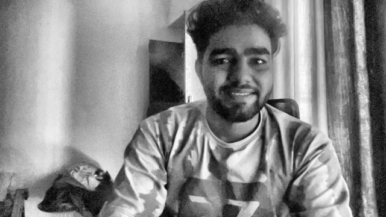 | 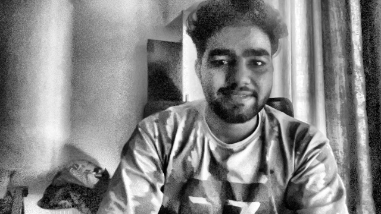 | 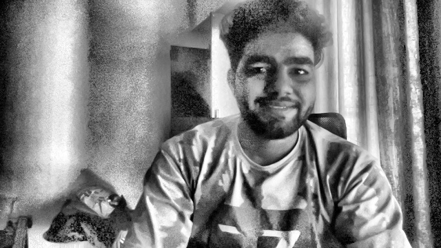 |
| Lower, more restrained local contrast; the setting used by the earlier pipeline. | Stronger local contrast. | Strongest local contrast of these examples; fine texture and noise are more pronounced. |

```text
FPS: 30.1858 | Avg Capture: 17.7814 ms | Avg Grayscale: 0.144911 ms | Avg Blur: 0.128394 ms
 | Avg Canny: 0.749479 ms
 | Avg CLAHE: 0.493008 ms
```

## Canny Edge detection

OpenCV's `cv::Canny` takes a lower threshold and an upper threshold. It first estimates image gradients, keeps local gradient maxima through non-maximum suppression, and then applies hysteresis:

- A pixel with gradient magnitude above the **upper threshold** is a strong edge candidate.
- A pixel below the **lower threshold** is rejected as an edge.
- A pixel between the two thresholds is a weak candidate. It is retained only when connected to a strong edge; otherwise hysteresis removes it.

The thresholds are gradient-strength cutoffs, not image brightness values or percentages. Raising both thresholds makes detection more selective and usually produces fewer edges. Lowering them makes detection more sensitive, retaining weaker boundaries but potentially adding noise. The Gaussian blur before Canny suppresses small variations that could otherwise create unstable edges. Threshold values should be judged against the input image and desired edge detail.

The earlier image-processing pipeline used `cv::Canny(blurredFrame, edges, 50, 150)`. The following saved 640×360 edge maps compare the three requested threshold pairs on the captured scene:

| Thresholds 25 and 75 | Thresholds 50 and 150 | Thresholds 100 and 200 |
| --- | --- | --- |
| 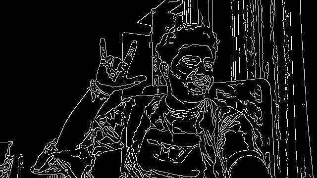 | 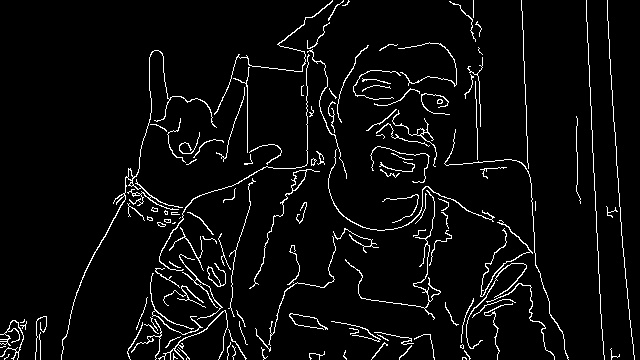 | 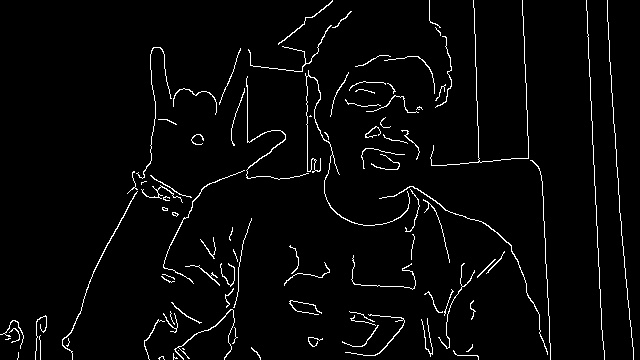 |
| More sensitive to weak gradients; more detail and potentially more noise survive. | The threshold pair used by the earlier Canny stage; balances weak detail and suppression in this scene. | More selective; fewer, stronger contours remain, while some low-contrast detail may disappear. |

### Recorded profiling result

```text
FPS: 28.9618 | Avg Capture: 17.6752 ms | Avg Grayscale: 0.184088 ms | Avg Blur: 0.1588 ms | Avg Canny: 1.03136 ms
```

## Profiling Run Screenshot

The terminal screenshot supplied with the earlier project run is not included as a repository file. The three Canny output images above are the captured files available for this comparison.

## Latest benchmark — 13 October 2026

- Processing FPS: 39.92
- Average inference: 10.84 ms
- Preprocessing: 0.57–0.66 ms
- Decode: 1.12 ms
- NMS: approximately 0.0006 ms
- Verified build: successful CMake configuration and build completed with `[100%] Built target vision_app`.

## Build and Run

This project requires CMake, a C++17 compiler, OpenCV development files with camera/video I/O support, ONNX Runtime development files, and the `yolo26n.onnx` model in the repository root.

```sh
cmake -S . -B build
cmake --build build
cd build && ./vision_app
```

Run the executable from `build/` so the code's `../yolo26n.onnx` model path resolves to the model in the repository root. When using VS Code with CMake Tools, configure the CMake project so the OpenCV and ONNX Runtime include directories and libraries are available to the target.

In the OpenCV window, press `s` to save the captured BGR frame or `q` to quit. The camera must be accessible to the application; on macOS, grant camera permission to the terminal or application launching it.