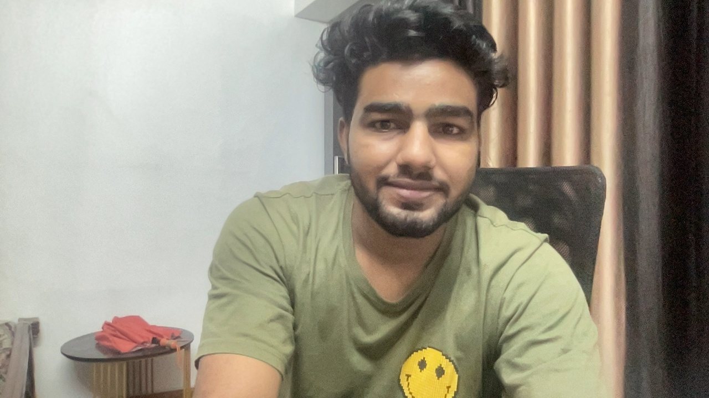
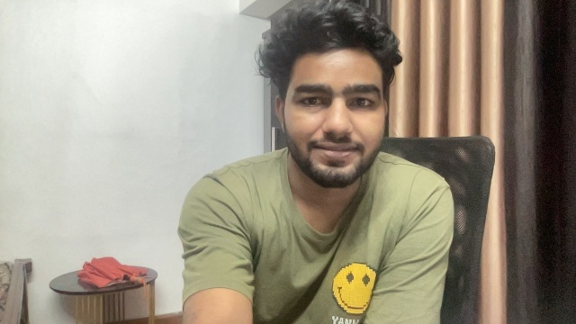
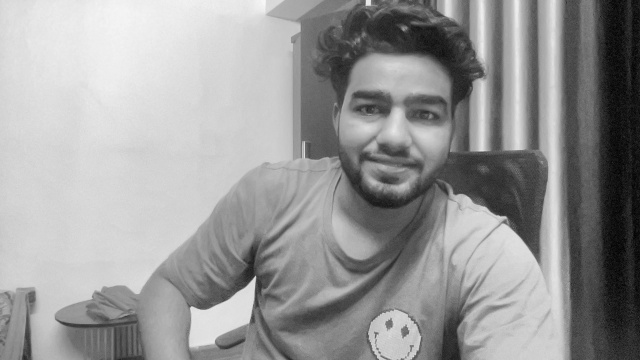

# Real-Time Vision Pipeline

A small C++17 and OpenCV application that reads frames from the default camera, resizes and preprocesses them, detects edges with Canny, displays the live edge map, and reports timing and frame-rate measurements.

## Pipeline

The application is implemented in [`src/main.cpp`](src/main.cpp) and runs the following stages for each camera frame:

1. **Camera acquisition**: `cv::VideoCapture cap(0)` opens camera device 0. `cap >> frame` retrieves a frame. `Avg Capture` measures this camera read only.
2. **Original-frame inspection**: on the first valid frame, the program prints its width, height, channel count, pixel count, OpenCV matrix type, and the BGR values at pixel `[0,0]`.
3. **Resize**: `cv::resize(frame, resizedFrame, cv::Size(640, 360))` creates a 640×360 color image. This is a fixed output size rather than an aspect-ratio-preserving fit.
4. **Grayscale and normalization**: `cv::cvtColor(resizedFrame, grayFrame, cv::COLOR_BGR2GRAY)` converts BGR to one-channel grayscale. `grayFrame.convertTo(normalizedFrame, CV_32F, 1.0 / 255.0)` creates a floating-point grayscale image scaled to `[0,1]` for inspection. In the current code, the blur and Canny stages use `grayFrame`, not `normalizedFrame`.
5. **Gaussian smoothing**: `cv::GaussianBlur(grayFrame, blurredFrame, cv::Size(5, 5), 0)` applies a 5×5 Gaussian kernel before edge detection. The zero sigma lets OpenCV derive the Gaussian standard deviation from the kernel size.
6. **Canny edge detection**: `cv::Canny(blurredFrame, edges, 50, 150)` produces a single-channel binary edge map. The displayed output is `edges`.
7. **Display and keyboard input**: `cv::imshow` displays the edge map. `cv::waitKey(1)` processes window events and checks for `s` or `q`.
8. **Optional save**: pressing `s` calls `cv::imwrite` to write the current edge map to `captured_frame_canny(50,150).jpg` in the process's working directory.
9. **Shutdown**: pressing `q` exits the loop; `cap.release()` and `cv::destroyAllWindows()` release the camera and display resources.

## OpenCV API Used

- `cv::VideoCapture` opens a camera; `isOpened()` tests whether the device was opened; the stream extraction operator reads a frame; `release()` closes the capture device.
- `cv::Mat` stores the original, resized, and grayscale images.
- `cv::resize` resamples an image to a specified size. This application requests 640×360.
- `cv::Size` represents the target width and height passed to `cv::resize`.
- `cv::cvtColor` applies a color-space conversion. `cv::COLOR_BGR2GRAY` specifies conversion from OpenCV's BGR channel order to grayscale.
- `cv::Mat::convertTo` converts image depth and optionally scales pixel values; `CV_32F` selects 32-bit floating point, and the scale `1.0 / 255.0` normalizes 8-bit grayscale values to `[0,1]`.
- `cv::GaussianBlur` reduces high-frequency noise before edge detection; `cv::Size(5, 5)` sets the kernel dimensions and `sigmaX=0` asks OpenCV to derive sigma from the kernel.
- `cv::Canny` detects edges using gradient magnitude, non-maximum suppression, and two-threshold hysteresis. The live pipeline calls it with thresholds `50` and `150`.
- `cv::Mat::rows`, `cols`, `channels()`, `total()`, and `type()` expose frame metadata; `at<cv::Vec3b>` accesses a BGR pixel and `at<unsigned char>` accesses one grayscale pixel.
- `cv::imshow` displays a frame, `cv::waitKey` handles GUI events and keyboard input, and `cv::destroyAllWindows` closes OpenCV windows.
- `cv::imwrite` encodes and saves the selected frame as an image file.
- `CV_VERSION` reports the OpenCV version used at compile time.

## Profiling and Bottleneck Notes

The code uses `std::chrono::steady_clock` and `std::chrono::duration<double, std::milli>` to measure elapsed wall-clock time. A monotonic clock is appropriate for durations because wall-clock adjustments do not affect it.

- **Capture time** (`Avg Capture`): the timer surrounds only `cap >> frame` and measures camera read/wait time.
- **Grayscale time** (`Avg Grayscale`): the timer includes both `cv::cvtColor` and conversion/normalization with `convertTo`.
- **Blur time** (`Avg Blur`): the timer measures `cv::GaussianBlur` using the 5×5 kernel.
- **Canny time** (`Avg Canny`): the timer measures only `cv::Canny` on the blurred grayscale image.
- **Unmeasured work**: resize, frame inspection, display, keyboard handling, and scheduling are not included in these individual stage timers. The FPS is the observed loop rate, not the reciprocal of the sum of the listed averages.
- **FPS**: `frameCount / elapsedSeconds` is calculated over roughly one-second reporting windows. This is the observed loop rate, including capture, processing, display/event handling, and scheduling; it is not a pure image-processing throughput measurement.

In the recorded run below, camera read is the largest of the explicitly timed stages; Canny takes about 1 ms, while grayscale/normalization and blur are each below 0.2 ms. Resize and display are not individually timed, so this snapshot does not establish their relative cost. Measurements vary with the camera, resolution, machine, and runtime conditions.

The original 1280×720 frame contains 921,600 pixels. Resizing to 640×360 reduces this to 230,400 pixels, one quarter as many. The grayscale output remains 640×360 but uses one channel instead of three, reducing image data per pixel from three channel values to one. These steps lower the amount of image data subsequent stages need to handle.

## Captured Frames

### Original camera frame



The unmodified camera frame is 1280×720 and has three BGR channels. It is the source image before the fixed-size resize and subsequent preprocessing.

### Resized color frame



The image is reduced from 1280×720 to 640×360 while retaining three BGR channels. Its pixel dimensions, and therefore pixel count, are one quarter of the original. The smaller frame is the input to the grayscale conversion.

### Grayscale frame



The frame remains 640×360, but BGR color has been converted to one grayscale channel using `cv::cvtColor` and `cv::COLOR_BGR2GRAY`. It is the input to the Gaussian blur. The live window now shows the Canny edge result, not this grayscale image.

## Canny Edge detection

OpenCV's `cv::Canny` takes a lower threshold and an upper threshold. It first estimates image gradients, keeps local gradient maxima through non-maximum suppression, and then applies hysteresis:

- A pixel with gradient magnitude above the **upper threshold** is a strong edge candidate.
- A pixel below the **lower threshold** is rejected as an edge.
- A pixel between the two thresholds is a weak candidate. It is retained only when connected to a strong edge; otherwise hysteresis removes it.

The thresholds are gradient-strength cutoffs, not image brightness values or percentages. Raising both thresholds makes detection more selective and usually produces fewer edges. Lowering them makes detection more sensitive, retaining weaker boundaries but potentially adding noise. The Gaussian blur before Canny suppresses small variations that could otherwise create unstable edges. Threshold values should be judged against the input image and desired edge detail.

The live application currently uses `cv::Canny(blurredFrame, edges, 50, 150)`. The following saved 640×360 edge maps compare the three requested threshold pairs on the captured scene:

### Thresholds 25 and 75

.jpg>)

The lower pair is more sensitive to weak gradients, so more fine details and weaker boundaries survive. It can also retain more texture or noise as edges.

### Thresholds 50 and 150

.jpg>)

This is the threshold pair used by the live pipeline. It balances weaker connected details against suppression of low-strength responses in this sample.

### Thresholds 100 and 200

.jpg>)

The higher pair is more selective: weak edges are removed, leaving fewer, stronger contours. Some useful low-contrast detail may disappear as well.

### Recorded profiling result

```text
FPS: 28.9618 | Avg Capture: 17.6752 ms | Avg Grayscale: 0.184088 ms | Avg Blur: 0.1588 ms | Avg Canny: 1.03136 ms
```

## Profiling Run Screenshot

The terminal screenshot supplied with the earlier project run is not included as a repository file. The three Canny output images above are the captured files available for this comparison.

## Build and Run

This project requires CMake, a C++17 compiler, and an OpenCV development installation with camera/video I/O support.

```sh
cmake -S . -B build
cmake --build build
./build/vision_app
```

When using VS Code with CMake Tools, configure the CMake project so the OpenCV include directories and libraries from `find_package(OpenCV REQUIRED)` are passed to the target.

In the OpenCV window, press `s` to save the displayed Canny edge map or `q` to quit. The camera must be accessible to the application; on macOS, grant camera permission to the terminal or application launching it.